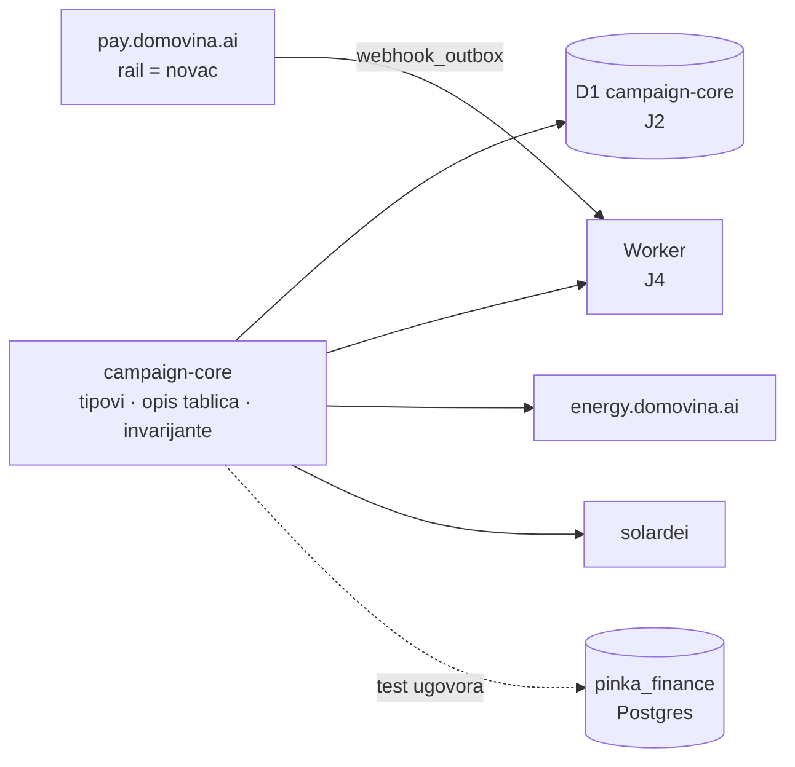
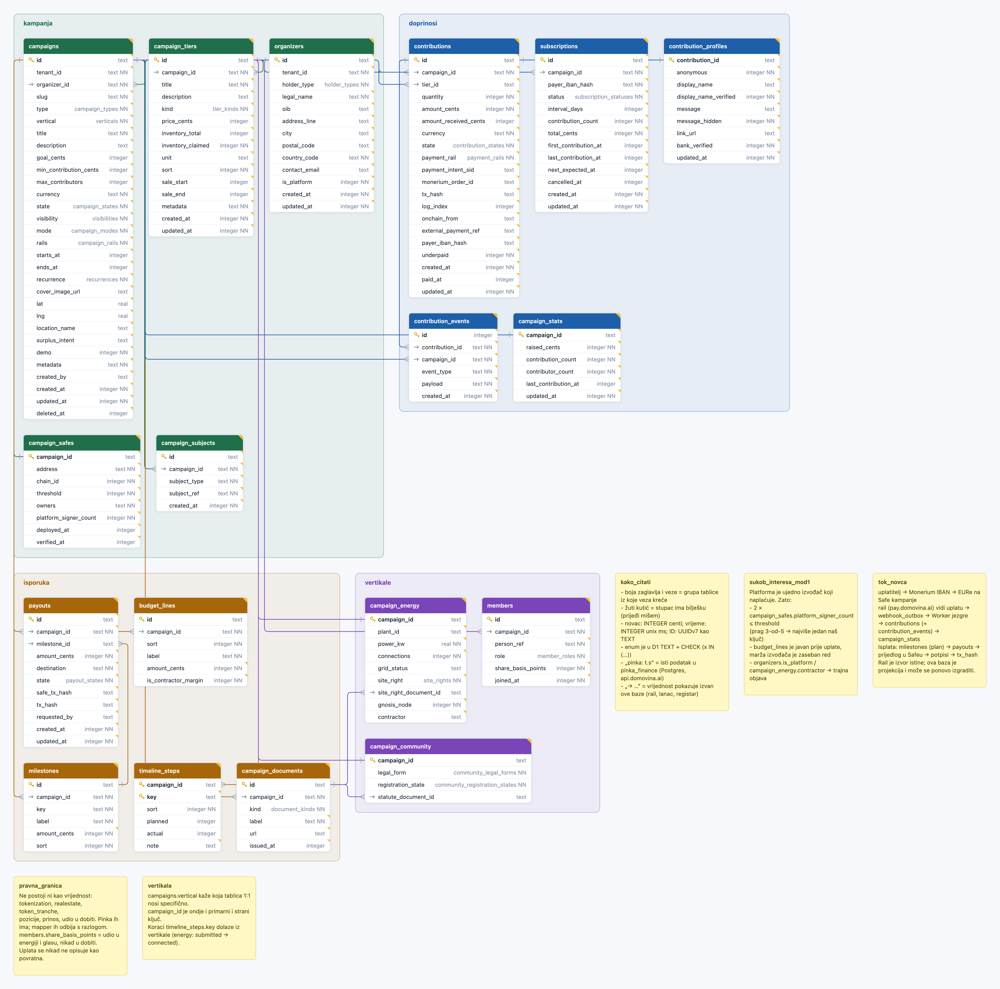

# campaign-core

Jezgra kampanje za P2P zajedničko financiranje na Cloudflareu: tipovi redaka,
opis zajedničkih tablica između D1 i `pinka_finance` (Postgres na
`api.domovina.ai`) i invarijante koje dijele svi frontendovi.

Odluke i obrazloženje: [energy.domovina.ai `docs/19`](https://github.com/domovinatv/energy.domovina.ai/blob/main/docs/19-podatkovna-jezgra-kampanje.md).



## Shema



[Otvori interaktivno u open-diagramu](https://stepanic.github.io/open-diagram/?url=https://github.com/domovinatv/campaign-core/blob/main/schema.dbml): pomicanje, zoom, bilješke
tablica, stupaca i vrijednosti enuma (prijeđi mišem). Pogledi:
[jezgra](https://stepanic.github.io/open-diagram/?url=https://github.com/domovinatv/campaign-core/blob/main/schema.dbml&view=jezgra) · [novac](https://stepanic.github.io/open-diagram/?url=https://github.com/domovinatv/campaign-core/blob/main/schema.dbml&view=novac) · [vertikale](https://stepanic.github.io/open-diagram/?url=https://github.com/domovinatv/campaign-core/blob/main/schema.dbml&view=vertikale).
Izvor: [`schema.dbml`](schema.dbml) · [SVG](docs/schema.svg)

`schema.dbml` se generira iz `src/contract.ts` (stupci, ključevi, veze, značenje u
`note`) i `src/dbml.ts` (grupe, boje, bilješke na platnu, pogledi); test pada ako
datoteka nije jednaka izlazu generatora.

| grupa | što drži |
|---|---|
| **kampanja** (zeleno) | kampanja, nositelj, Safe s potpisnicima, predmet, paketi |
| **isporuka** (smeđe) | javna razrada troška, plan i izvedba isplate, tijek, dokumenti |
| **doprinosi** (plavo) | knjiga doprinosa i dnevnik, javni prikaz, agregat, ponavljanje; projekcija raila |
| **vertikale** (ljubičasto) | elektrana, zajednica, članovi: 1:1 uz kampanju |

Bilješke na platnu: kako čitati, tok novca, sukob interesa (Mod 1), pravna granica, vertikala.

## Što je ovdje

| datoteka | sadržaj |
|---|---|
| `src/sets.ts` | zatvoreni skupovi vrijednosti (`type`, `state`, `visibility`, …); u D1 postaju `CHECK` |
| `src/types.ts` | tip retka za svaku tablicu jezgre i vertikala |
| `src/contract.ts` | opis stupaca: SQLite tip, NULL, skup, JSON/boolean, ime u `pinka_finance` |
| `src/invariants.ts` | sukob interesa (P7), Mod 2 bez naših ključeva, upotrebljiv Safe, faza isporuke |
| `src/mapping.ts` | pinka ↔ jezgra i stari energy model → jezgra; ono što je izvan pravne granice se odbija |
| `src/dbml.ts` | `schema.dbml` iz opisa tablica |
| `contract/pinka-columns.json` | snimka stupaca `pinka_finance` iz žive baze |

## Upotreba

```bash
npm install github:domovinatv/campaign-core#v0.2.0
```

```ts
import { violatesConflictInvariant, CAMPAIGN_TYPES, type Campaign } from "@domovina/campaign-core";
```

Paket se gradi pri instalaciji (`prepare`), pa `dist/` nije u gitu.

## Razvoj

```bash
npm run verify          # typecheck + test + build
npm run snapshot:pinka  # osvježi contract/pinka-columns.json (treba domovina-api i SSH)
npm run dbml            # schema.dbml iz src/contract.ts
npm run diagram         # docs/schema.{png,svg} (treba klon stepanic/open-diagram, OPEN_DIAGRAM=…)
```

Test ugovora pada ako je snimka starija od 30 dana ili ako stupac na koji se
opis poziva više ne postoji u `pinka_finance`.

## Licenca

MIT
